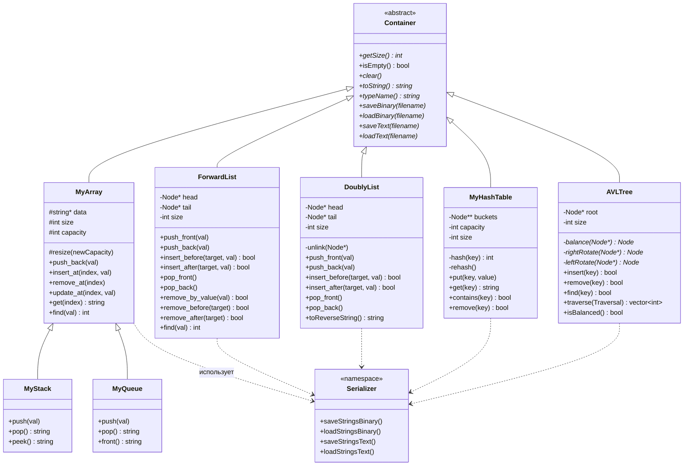
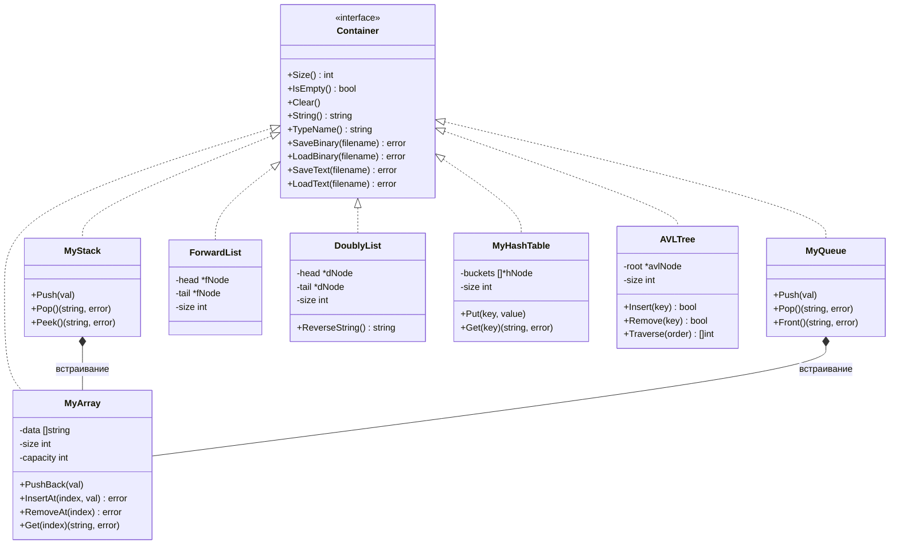

# UML-диаграммы классов

Диаграммы в формате Mermaid: открываются на GitHub или в https://mermaid.live.

## C++

## Go

Обозначения: сплошная линия с треугольником — наследование, пунктир с треугольником — реализация
интерфейса, ромб — встраивание (композиция), пунктирная стрелка — зависимость.
